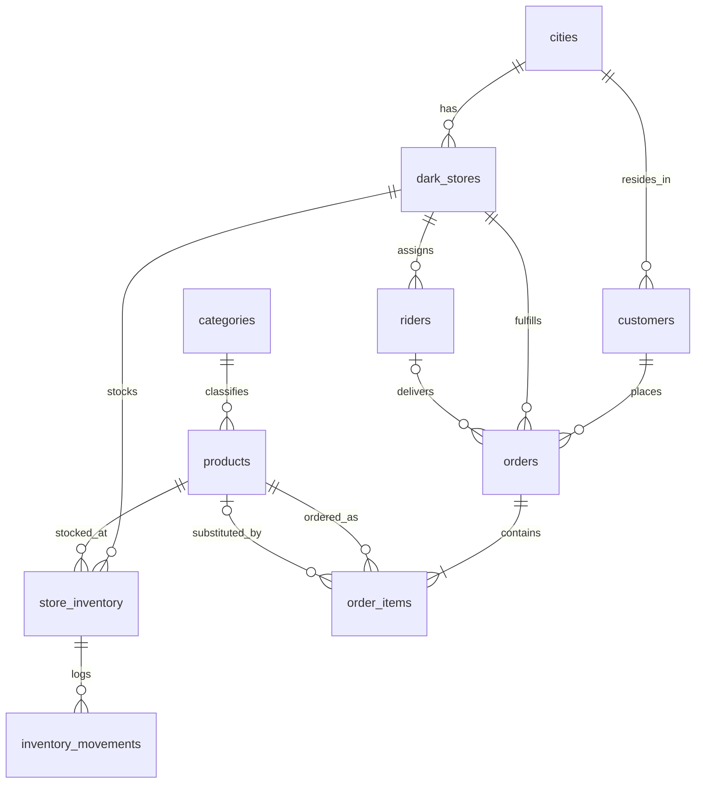

# Phase 2: Schema Design, Normalization & Data Audit

**Schema:** `blinkit` (`sql/01_schema.sql`)  
**Loader:** `sql/02_load_data.sql`  
**ER Diagram:** [er_diagram.png](../diagrams/er_diagram.png)

---

## 1. Data Dictionary (All 10 Tables)

### 1.1 `cities` (10 rows)
| Column | Type | Constraints | Why |
|---|---|---|---|
| `city_id` | `SMALLINT` | `PRIMARY KEY` | Small surrogate ID (1–10; fits well within 32,767). |
| `city_name` | `VARCHAR(50)` | `NOT NULL`, `UNIQUE` (`uq_cities_name`) | Natural candidate key; prevents duplicate city entries. |
| `state` | `VARCHAR(50)` | `NOT NULL` | Required administrative state/UT (multiple cities may share a state, e.g., Maharashtra). |

### 1.2 `categories` (12 rows)
| Column | Type | Constraints | Why |
|---|---|---|---|
| `category_id` | `SMALLINT` | `PRIMARY KEY` | Small surrogate category ID (1–12). |
| `category_name` | `VARCHAR(50)` | `NOT NULL`, `UNIQUE` (`uq_categories_name`) | Natural candidate key used directly by `R02` (`'Dairy'`) and `R19` (`'Fruits & Vegetables'`). |
| `is_perishable` | `BOOLEAN` | `NOT NULL` | CSV uses `t`/`f`; drives shelf-life expectation for products. |

### 1.3 `dark_stores` (120 rows)
| Column | Type | Constraints | Why |
|---|---|---|---|
| `store_id` | `INTEGER` | `PRIMARY KEY` | Surrogate store ID; `INTEGER` safely accommodates 20×–100× store expansion. |
| `store_code` | `VARCHAR(10)` | `NOT NULL`, `UNIQUE` (`uq_dark_stores_code`), `CHECK (store_code ~ '^[A-Z]{3}-[A-Z]{3}-[0-9]{2}$')` | Short fixed-pattern human code like `MUM-AND-11`. |
| `city_id` | `SMALLINT` | `NOT NULL`, `REFERENCES cities(city_id) ON DELETE RESTRICT` | Every dark store operates in a city; `RESTRICT` prevents deleting active cities. |
| `latitude` | `NUMERIC(9,6)` | `NOT NULL`, `CHECK (latitude BETWEEN -90 AND 90)` | Exact 6-decimal GPS latitude for Haversine/bounding-box lookup (`R01`). |
| `longitude` | `NUMERIC(9,6)` | `NOT NULL`, `CHECK (longitude BETWEEN -180 AND 180)` | Exact 6-decimal GPS longitude for Haversine/bounding-box lookup (`R01`). |
| `opened_on` | `DATE` | `NOT NULL` | Calendar date without time component. |
| `is_active` | `BOOLEAN` | `NOT NULL` | Flags closed/inactive stores (`store_id` 51, 74 are `false`). |
| `max_daily_orders` | `SMALLINT` | `NOT NULL`, `CHECK (max_daily_orders > 0)` | Store throughput cap (1,500–3,000 in seed data). |

### 1.4 `products` (1,500 rows)
| Column | Type | Constraints | Why |
|---|---|---|---|
| `product_id` | `INTEGER` | `PRIMARY KEY` | Surrogate product ID (`INTEGER` avoids `SMALLINT` overflow at 20×+). |
| `sku` | `VARCHAR(12)` | `NOT NULL`, `UNIQUE` (`uq_products_sku`), `CHECK (sku ~ '^BK[0-9]{8}$')` | Natural warehouse barcode key (`BK` + 8 digits), used by `R23`. |
| `product_name` | `VARCHAR(120)` | `NOT NULL` | Display name; **not** `UNIQUE` (70 names repeat across 1,500 SKUs). |
| `brand` | `VARCHAR(60)` | `NOT NULL` | Brand attribute. |
| `category_id` | `SMALLINT` | `NOT NULL`, `REFERENCES categories(category_id) ON DELETE RESTRICT` | Product taxonomy link. |
| `pack_size` | `VARCHAR(30)` | `NOT NULL` | Unit size label (`1 kg`, `400 g`, `6 pcs`, etc.). |
| `mrp` | `NUMERIC(10,2)` | `NOT NULL`, `CHECK (mrp > 0)` | Exact base-10 monetary MRP; never `FLOAT` to avoid rounding drift. |
| `shelf_life_days` | `SMALLINT` | `NULL`, `CHECK (shelf_life_days IS NULL OR shelf_life_days > 0)` | Nullable: populated (`3`–`180`) only for perishable categories (`categories.is_perishable = true`), `NULL` for all 875 non-perishable items. |
| `is_active` | `BOOLEAN` | `NOT NULL` | Soft-delete/listing toggle (`1,463` active, `37` inactive). |

### 1.5 `store_inventory` (126,000 rows)
| Column | Type | Constraints | Why |
|---|---|---|---|
| `store_id` | `INTEGER` | `NOT NULL`, `REFERENCES dark_stores(store_id) ON DELETE RESTRICT`, `PK (1/2)` | Store side of composite PK (`120` stores × `1,050` SKUs/store). |
| `product_id` | `INTEGER` | `NOT NULL`, `REFERENCES products(product_id) ON DELETE RESTRICT`, `PK (2/2)` | Product side of composite PK; ensures at most one inventory record per `(store_id, product_id)`. |
| `quantity_on_hand` | `INTEGER` | `NOT NULL`, `CHECK (quantity_on_hand >= 0)` | Non-negative live stock count (`0`–`60` in seed). |
| `reorder_level` | `INTEGER` | `NOT NULL`, `CHECK (reorder_level >= 0)` | Store-level replenishment trigger (`5`–`15`). |
| `selling_price` | `NUMERIC(10,2)` | `NOT NULL`, `CHECK (selling_price > 0)` | Store-specific selling price (`<= products.mrp` across all rows). |
| `updated_at` | `TIMESTAMPTZ` | `NOT NULL` | Timezone-aware last inventory update timestamp (`+05:30`). |

### 1.6 `customers` (40,000 rows)
| Column | Type | Constraints | Why |
|---|---|---|---|
| `customer_id` | `INTEGER` | `PRIMARY KEY` | Surrogate customer ID (`INTEGER` scales cleanly past 800k+ at 20×). |
| `full_name` | `VARCHAR(100)` | `NOT NULL` | Customer name. |
| `phone` | `VARCHAR(10)` | `NOT NULL`, `UNIQUE` (`uq_customers_phone`), `CHECK (phone ~ '^[0-9]{10}$')` | 10-digit Indian mobile login identifier; candidate key. |
| `email` | `VARCHAR(150)` | `NULL`, `UNIQUE` (`uq_customers_email`), `CHECK (email IS NULL OR email ~* '^[^@\s]+@[^@\s]+\.[^@\s]+$')` | Nullable (`18,023` missing; customers sign up with phone first). PostgreSQL `UNIQUE` permits multiple `NULL`s while ensuring uniqueness across all `21,977` non-null emails. |
| `city_id` | `SMALLINT` | `NOT NULL`, `REFERENCES cities(city_id) ON DELETE RESTRICT` | Customer's registered city. |
| `created_at` | `TIMESTAMPTZ` | `NOT NULL` | Account creation timestamp with timezone offset. |

### 1.7 `riders` (1,800 rows)
| Column | Type | Constraints | Why |
|---|---|---|---|
| `rider_id` | `INTEGER` | `PRIMARY KEY` | Surrogate rider ID. |
| `full_name` | `VARCHAR(100)` | `NOT NULL` | Rider name. |
| `phone` | `VARCHAR(10)` | `NOT NULL`, `UNIQUE` (`uq_riders_phone`), `CHECK (phone ~ '^[0-9]{10}$')` | 10-digit rider contact number; candidate key. |
| `store_id` | `INTEGER` | `NOT NULL`, `REFERENCES dark_stores(store_id) ON DELETE RESTRICT` | Home dark store to which the rider is assigned (`15` riders/store avg). |
| `joined_on` | `DATE` | `NOT NULL` | Onboarding calendar date. |
| `status` | `VARCHAR(20)` | `NOT NULL`, `CHECK (status IN ('ACTIVE', 'ON_LEAVE', 'EXITED'))` | Employment/availability state (`1,517` ACTIVE, `163` ON_LEAVE, `120` EXITED). |

### 1.8 `orders` (150,000 rows)
| Column | Type | Constraints | Why |
|---|---|---|---|
| `order_id` | `BIGINT` | `PRIMARY KEY` | High-growth transaction ID (`W01` inserts `90000001`; `BIGINT` supports billions of orders). |
| `customer_id` | `INTEGER` | `NOT NULL`, `REFERENCES customers(customer_id) ON DELETE RESTRICT` | Ordering customer; `RESTRICT` protects financial history. |
| `store_id` | `INTEGER` | `NOT NULL`, `REFERENCES dark_stores(store_id) ON DELETE RESTRICT` | Fulfilling dark store. |
| `rider_id` | `INTEGER` | `NULL`, `REFERENCES riders(rider_id) ON DELETE SET NULL` | Nullable (`5,822` NULL) because `PLACED`, `PACKING`, and pre-pickup `CANCELLED` orders have no assigned rider yet; `SET NULL` preserves order records if a rider profile were ever purged. |
| `placed_at` | `TIMESTAMPTZ` | `NOT NULL` | Checkout timestamp with timezone. |
| `packed_at` | `TIMESTAMPTZ` | `NULL` | Empty (`2,885` NULL) for `PLACED` (`35`) and pre-pack `CANCELLED` (`2,850`) orders. |
| `picked_up_at` | `TIMESTAMPTZ` | `NULL` | Empty (`5,822` NULL) until `OUT_FOR_DELIVERY` / `DELIVERED`. |
| `delivered_at` | `TIMESTAMPTZ` | `NULL` | Empty (`5,857` NULL) for all non-`DELIVERED` orders (`PLACED`, `PACKING`, `OUT_FOR_DELIVERY`, `CANCELLED`). |
| `promised_minutes` | `SMALLINT` | `NOT NULL`, `DEFAULT 10`, `CHECK (promised_minutes > 0)` | SLA promise (`10` mins); `DEFAULT 10` is required because `W01` omits `promised_minutes` on `INSERT`. |
| `subtotal` | `NUMERIC(10,2)` | `NOT NULL`, `CHECK (subtotal >= 0)` | Sum of delivered line items (`SUM(quantity_delivered * unit_price)`). |
| `delivery_fee` | `NUMERIC(10,2)` | `NOT NULL`, `CHECK (delivery_fee >= 0)` | `25.00` when `subtotal < 199`, `0.00` when `subtotal >= 199` (`chk_order_delivery_rule`). |
| `handling_fee` | `NUMERIC(10,2)` | `NOT NULL`, `CHECK (handling_fee >= 0)` | `6.00` when `subtotal < 500`, `2.00` when `subtotal >= 500` in seed data. |
| `small_cart_fee` | `NUMERIC(10,2)` | `NOT NULL`, `CHECK (small_cart_fee >= 0)` | `0.00` across all seed rows (min `subtotal` is `107.00`). |
| `total_amount` | `NUMERIC(10,2)` | `NOT NULL`, `CHECK (total_amount = subtotal + delivery_fee + handling_fee + small_cart_fee)` | Enforces exact bill arithmetic. |
| `payment_method` | `VARCHAR(20)` | `NOT NULL`, `CHECK (payment_method IN ('UPI', 'COD', 'CARD', 'WALLET'))` | Validated payment tender. |
| `status` | `VARCHAR(20)` | `NOT NULL`, `CHECK (status IN ('PLACED', 'PACKING', 'OUT_FOR_DELIVERY', 'DELIVERED', 'CANCELLED'))` | Order state machine enforced together with `chk_order_time_sequence` and `chk_order_lifecycle`. |

### 1.9 `order_items` (675,000 rows)
| Column | Type | Constraints | Why |
|---|---|---|---|
| `order_id` | `BIGINT` | `NOT NULL`, `REFERENCES orders(order_id) ON DELETE CASCADE`, `PK (1/2)` | Line items have no meaning without their parent order (`CASCADE` removes orphan lines if an order is deleted). |
| `product_id` | `INTEGER` | `NOT NULL`, `REFERENCES products(product_id) ON DELETE RESTRICT`, `PK (2/2)` | One line per `(order_id, product_id)`; `RESTRICT` prevents deleting ordered SKUs. |
| `quantity_ordered` | `SMALLINT` | `NOT NULL`, `CHECK (quantity_ordered > 0)` | Units requested (`1`–`3`). |
| `quantity_delivered` | `SMALLINT` | `NOT NULL`, `CHECK (quantity_delivered >= 0 AND quantity_delivered <= quantity_ordered)` | Units fulfilled (`0`–`3`, never exceeds ordered). |
| `unit_price` | `NUMERIC(10,2)` | `NOT NULL`, `CHECK (unit_price > 0)` | Historical price snapshot from `store_inventory.selling_price` at order time. |
| `substitute_product_id` | `INTEGER` | `NULL`, `REFERENCES products(product_id) ON DELETE SET NULL` | Nullable (`660,000` NULL); only populated (`15,000` rows) when `quantity_delivered < quantity_ordered` and `substitute_product_id <> product_id` (`chk_oi_substitute_rule`). |

### 1.10 `inventory_movements` (90,000 rows)
| Column | Type | Constraints | Why |
|---|---|---|---|
| `movement_id` | `BIGINT` | `PRIMARY KEY` | Surrogate movement log ID (`BIGINT` scales past 100×). |
| `store_id` | `INTEGER` | `NOT NULL`, `FK (1/2)` | Store where stock moved. |
| `product_id` | `INTEGER` | `NOT NULL`, `FK (2/2)` | Product whose stock moved. **Composite FK** `(store_id, product_id) REFERENCES store_inventory(store_id, product_id) ON DELETE RESTRICT` ensures every movement targets an actual stocked `(store_id, product_id)` pair. |
| `movement_type` | `VARCHAR(20)` | `NOT NULL`, `CHECK (movement_type IN ('RESTOCK', 'DAMAGE', 'EXPIRY', 'ADJUSTMENT'))` | Movement reason code. |
| `quantity` | `INTEGER` | `NOT NULL`, `CHECK (chk_mov_qty_sign)` | Signed delta: `> 0` for `RESTOCK`, `< 0` for `DAMAGE`/`EXPIRY`, `<> 0` for `ADJUSTMENT`. |
| `moved_at` | `TIMESTAMPTZ` | `NOT NULL` | Event timestamp with timezone offset. |

---

## 2. Foreign Key `ON DELETE` Policy Summary

| Child Table | FK Column(s) | Parent Table | `ON DELETE` Rule | Rationale |
|---|---|---|---|---|
| `dark_stores` | `city_id` | `cities` | `RESTRICT` | Cannot delete a city that still houses dark stores. |
| `customers` | `city_id` | `cities` | `RESTRICT` | Cannot delete a city with registered customers. |
| `products` | `category_id` | `categories` | `RESTRICT` | Cannot delete a category that still contains products. |
| `store_inventory` | `store_id`, `product_id` | `dark_stores`, `products` | `RESTRICT` | Prevents wiping live store pricing/stock while references exist; deactivate via `is_active = false`. |
| `riders` | `store_id` | `dark_stores` | `RESTRICT` | Prevents deleting a store with assigned riders; deactivate store instead. |
| `orders` | `customer_id`, `store_id` | `customers`, `dark_stores` | `RESTRICT` | Protects financial/audit history against accidental customer/store deletion. |
| `orders` | `rider_id` | `riders` | `SET NULL` | Rider assignment is optional/historical; if a rider record is ever removed, retain the order with `rider_id = NULL` (note: only valid for non-active/historical audit handling—in practice riders use `status = 'EXITED'`). |
| `order_items` | `order_id` | `orders` | `CASCADE` | Order lines are weak/dependent entities owned solely by the parent order. |
| `order_items` | `product_id` | `products` | `RESTRICT` | Protects historical invoices from broken product links. |
| `order_items` | `substitute_product_id` | `products` | `SET NULL` | Substitution reference is optional metadata; line item survives if a substitute SKU were ever purged. |
| `inventory_movements` | `(store_id, product_id)` | `store_inventory` | `RESTRICT` | Ledger audit log cannot outlive or orphan its parent inventory cell. |

---

## 3. Auto-Created Indexes (Phase 2 Baseline — No Tuning Indexes Added)

Per Phase 2 rules, zero explicit `CREATE INDEX` statements were written in `sql/01_schema.sql`. PostgreSQL automatically creates 17 B-tree unique indexes backing `PRIMARY KEY` and `UNIQUE` constraints:
- **PKs (10):** `categories_pkey(category_id)`, `cities_pkey(city_id)`, `customers_pkey(customer_id)`, `dark_stores_pkey(store_id)`, `inventory_movements_pkey(movement_id)`, `order_items_pkey(order_id, product_id)`, `orders_pkey(order_id)`, `products_pkey(product_id)`, `riders_pkey(rider_id)`, `store_inventory_pkey(store_id, product_id)`.
- **UNIQUEs (7):** `uq_categories_name(category_name)`, `uq_cities_name(city_name)`, `uq_customers_email(email)`, `uq_customers_phone(phone)`, `uq_dark_stores_code(store_code)`, `uq_products_sku(sku)`, `uq_riders_phone(phone)`.

---

## 4. Entity-Relationship Diagram & Cardinalities

Full high-resolution diagram: [diagrams/er_diagram.png](../diagrams/er_diagram.png)

- `cities` 1 ── N `dark_stores` (one city operates many dark stores)
- `cities` 1 ── N `customers` (one city has many registered customers)
- `dark_stores` 1 ── N `riders` (one dark store employs many riders)
- `categories` 1 ── N `products` (one category classifies many SKUs)
- `dark_stores` M ── N `products` resolved via `store_inventory` (1:N from each parent)
- `store_inventory` 1 ── N `inventory_movements` via composite FK `(store_id, product_id)`
- `customers` 1 ── N `orders` (one customer places many orders)
- `dark_stores` 1 ── N `orders` (one dark store fulfills many orders)
- `riders` 0..1 ── N `orders` (optional rider assignment until dispatch)
- `orders` M ── N `products` resolved via `order_items` (plus optional `0..1:N` `substitute_product_id` FK to `products`)

---

## 5. Normalization & Functional Dependency Analysis (3NF / BCNF)

Every table satisfies **1NF** (atomic scalar columns, no repeating groups, well-defined primary keys), **2NF** (no partial dependencies on composite PKs `store_inventory(store_id, product_id)` and `order_items(order_id, product_id)`), **3NF**, and **BCNF** (every non-trivial FD's determinant is a superkey):

| Table | Candidate Key(s) | Functional Dependencies (FDs) | Normal Form |
|---|---|---|---|
| `cities` | `city_id`, `city_name` | `city_id -> city_name, state`; `city_name -> city_id, state` | BCNF |
| `categories` | `category_id`, `category_name` | `category_id -> category_name, is_perishable`; `category_name -> category_id, is_perishable` | BCNF |
| `dark_stores` | `store_id`, `store_code` | `store_id <-> store_code -> city_id, latitude, longitude, opened_on, is_active, max_daily_orders` | BCNF |
| `products` | `product_id`, `sku` | `product_id <-> sku -> product_name, brand, category_id, pack_size, mrp, shelf_life_days, is_active` | BCNF |
| `store_inventory` | `(store_id, product_id)` | `(store_id, product_id) -> quantity_on_hand, reorder_level, selling_price, updated_at` | BCNF |
| `customers` | `customer_id`, `phone` (and `email` when non-null) | `customer_id <-> phone -> full_name, email, city_id, created_at` | BCNF |
| `riders` | `rider_id`, `phone` | `rider_id <-> phone -> full_name, store_id, joined_on, status` | BCNF |
| `orders` | `order_id` | `order_id -> customer_id, store_id, rider_id, placed_at, packed_at, picked_up_at, delivered_at, promised_minutes, subtotal, delivery_fee, handling_fee, small_cart_fee, total_amount, payment_method, status` | BCNF (structural); see derived-column note below |
| `order_items` | `(order_id, product_id)` | `(order_id, product_id) -> quantity_ordered, quantity_delivered, unit_price, substitute_product_id` | BCNF |
| `inventory_movements` | `movement_id` | `movement_id -> store_id, product_id, movement_type, quantity, moved_at` | BCNF |

### Derived / Redundant Columns & Justification
1. **`orders.subtotal` vs `SUM(order_items.quantity_delivered * unit_price)`:** Controlled denormalization. Keeping `subtotal` on `orders` avoids joining and aggregating `order_items` (675k → 13.5M rows) on order-history, fee, and GMV queries (`R06`, `R17`, `R20`, `R22`, `R25`).
2. **`orders.delivery_fee`, `handling_fee`, `small_cart_fee`, `total_amount`:** `total_amount` is strictly derived (`subtotal + delivery_fee + handling_fee + small_cart_fee`), and `delivery_fee` / `handling_fee` follow checkout fee tiers (`subtotal < 199 => 25`, `subtotal < 500 => 6` else `2`). Storing them as point-in-time invoice columns is **justified** because fee schedules change over time and historical orders must preserve the exact amounts charged at checkout.
3. **`store_inventory.quantity_on_hand` vs `inventory_movements` & `order_items`:** Operational balance cache. Recomputing stock on every cart check (`R05`) or category page (`R02`) by summing historical movements and sales would destroy sub-5 ms checkout latency—and is impossible from the CSVs alone because movements begin `2025-01-01` without an opening balance snapshot.
4. **`order_items.unit_price` vs `store_inventory.selling_price`:** Stores the historical price at checkout time; although current seed `unit_price` equals current `selling_price` across all 675k rows, keeping `unit_price` on `order_items` is **mandatory** so future store price updates do not retroactively corrupt past invoices.

---

## 6. Load Verification & Integrity Check Results

All 10 CSV files loaded cleanly with zero constraint rejections:
- `cities`: **10** · `categories`: **12** · `dark_stores`: **120** · `products`: **1,500** · `store_inventory`: **126,000** · `customers`: **40,000** · `riders`: **1,800** · `orders`: **150,000** · `order_items`: **675,000** · `inventory_movements`: **90,000**.

Cross-table SQL integrity checks executed directly on `blinkit_db`:
1. **Every ordered product is stocked by the order's dark store:** `0` violations.
2. **Every assigned rider belongs to the order's dark store:** `0` violations.
3. **Every substitute product is stocked by the same dark store:** `0` violations.
4. **Every customer orders only from dark stores in their own city:** `0` violations.
5. **`store_inventory.selling_price <= products.mrp` and `order_items.unit_price = store_inventory.selling_price`:** `0` violations.
6. **`orders.subtotal = SUM(order_items.quantity_delivered * unit_price)`:** `0` violations across all 150,000 orders.
7. **Every `inventory_movements(store_id, product_id)` exists in `store_inventory`:** `0` violations.

---

## 7. Data Problems & Anomalies Discovered in Seed Export

1. **Orders placed before customer registration (`25,171` rows):** `orders.placed_at < customers.created_at` (for example, synthetic timestamps generated independently).
2. **Orders assigned before rider join date (`23,231` rows):** `orders.placed_at::date < riders.joined_on`.
3. **Active `OUT_FOR_DELIVERY` orders held by `EXITED`/`ON_LEAVE` riders (`5` rows):** `3` `OUT_FOR_DELIVERY` orders point to `EXITED` riders and `2` point to `ON_LEAVE` riders (plus historical `DELIVERED` orders referencing `EXITED`/`ON_LEAVE` riders, which is expected).
4. **Cancelled orders still carrying non-zero delivered quantities (`25,419` line items):** On `CANCELLED` orders, `25,419` `order_items` lines retain `quantity_delivered > 0` and non-zero `orders.subtotal`/`total_amount` (only `367` lines have `quantity_delivered = 0`).
5. **Orders & substitutions referencing inactive products:** `15,033` `order_items` lines reference products with `products.is_active = false`, and `609` substitutions point to inactive substitute products (valid historically if deactivated later, so enforced softly rather than rejected).
6. **Cross-category substitutions (`15,000` / `15,000` rows):** Every non-null `substitute_product_id` in the seed export belongs to a *different* `category_id` than the original `product_id` (an artifact of synthetic substitute sampling across store inventory).
7. **Duplicate `product_name` across multiple SKUs:** Only `70` distinct `product_name` values exist across `1,500` rows (e.g., `Vim Detergent 1 kg` repeats across 42 distinct SKUs/MRPs), confirming `product_name` cannot carry a `UNIQUE` constraint.
8. **`small_cart_fee` always `0.00`:** Every order in the seed dataset has `subtotal >= 107.00`, so the small-cart threshold is never triggered (`R17` returns `0.00` for every city/month).
9. **Unreconciled `quantity_on_hand`:** `store_inventory.quantity_on_hand` does not equal `SUM(inventory_movements.quantity) - SUM(delivered order_items)` because pre-2025 opening stock balances are absent from the movement log.
10. **Schema requirement surfaced by `W01`:** `workload_30.sql` query `W01` omits `promised_minutes` from its `INSERT` column list, requiring `promised_minutes SMALLINT NOT NULL DEFAULT 10` in `01_schema.sql`.