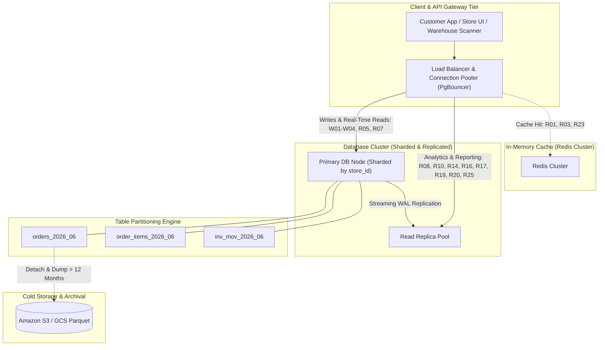

# Phase 5 – Scalability Report
 
**Team:** T0053 | **Lead:** Moksh Bansal | **Members:** Mrinal Upreti, Abhishek Pradhan, Subham Sekhar Mandal | **Database:** blinkit_db (PostgreSQL 18.6) | **Machine:** Apple MacBook Pro  
**Seed data:** 150k orders · 675k order items · 126k store inventory · 90k movements · 40k customers · 1.8k riders · 120 dark stores  
**Large data (20×):** 3M orders · 13.5M order items · 2.52M store inventory · 1.8M movements · 800k customers · 36k riders · 2,400 dark stores  
**Status:** Partitioning DDL complete and verified on seed data (`sql/08_partitioning.sql`). Seed and large-dataset timings below are **measured** (avg / median / min / max over repeated runs). The partition-drop timing for W05 (~2.5 ms) is still an estimate and has not been re-measured on the large dataset.  
**Convention:** "Meets target?" is judged on the **average** latency. Medians are shown where the average is distorted by outliers (typically first-run cold-cache effects).
 
---
 
## Results Table
 
| Query | Seed avg (ms) | Large avg (ms) | Large median (ms) | Large max (ms) | Growth (avg) | Meets target? | Target | Notes |
|-------|-------:|-------:|-------:|-------:|-------:|:---:|-------:|-------|
| R01 | 0.092 | 0.220 | 0.136 | 0.397 | 2.4× | ✅ | 5 ms | Index Only Scan on partial `idx_dark_stores_active_coords` |
| R02 | 0.300 | 0.857 | 0.560 | 1.577 | 2.9× | ✅ | 5 ms | Covering indexes on `store_inventory` and `products`; no in-memory sort |
| R03 | 0.295 | 2.021 | 0.782 | 4.546 | 6.9× | ✅ | 5 ms | GIN trigram bitmap scan (`idx_products_name_trgm`); closest real-time query to its SLA (max 4.5 ms) |
| R04 | 0.074 | 0.402 | 0.181 | 0.848 | 5.4× | ✅ | 5 ms | Index Only Scan `idx_store_inv_product_store` |
| R05 | 0.058 | 0.231 | 0.052 | 0.592 | 4.0× | ✅ | 5 ms | Median flat vs seed; average inflated by outliers |
| R06 | 0.049 | 0.178 | 0.040 | 0.457 | 3.6× | ✅ | 5 ms | Median flat vs seed; Index Only Scan `idx_orders_customer_placed` |
| R07 | 0.043 | 0.137 | 0.032 | 0.346 | 3.2× | ✅ | 5 ms | Partial index on open orders; median flat vs seed |
| R08 | 0.090 | 1.035 | 0.724 | 1.664 | 11.5× | ✅ | 5,000 ms | Reads pre-aggregated `mv_monthly_store_order_metrics` |
| R09 | 0.216 | 1.900 | 1.704 | 2.345 | 8.8× | ✅ | 5 ms | Partial low-stock index; grows with low-stock rows per store |
| R10 | 0.362 | 5.282 | 4.973 | 5.956 | 14.6× | ✅ | 5,000 ms | Partial wastage index `idx_mov_wastage_moved`; scales with June wastage events |
| R11 | 0.071 | 0.160 | 0.060 | 0.363 | 2.3× | ✅ | 250 ms | Index Only Scan `idx_orders_store_placed` |
| R12 | 1.496 | 39.912 | 1.482 | 116.788 | 26.7× | ✅ | 250 ms | Large spread (median 1.5 ms, max 117 ms); co-purchase self-join on `order_items` |
| R13 | 1.855 | **600.002** | 474.386 | 893.345 | **323×** | ❌ | 250 ms | **Misses target.** Plan changed at scale to index scans on `products_pkey` / `orders_pkey`; see "What Broke at Scale" |
| R14 | 0.095 | 0.896 | 0.655 | 1.415 | 9.4× | ✅ | 5,000 ms | Reads pre-aggregated `mv_monthly_store_fill_rate` |
| R15 | 0.110 | 1.155 | 0.846 | 1.800 | 10.5× | ✅ | 250 ms | Sargable date range on `idx_orders_placed_desc` |
| R16 | 0.059 | 0.066 | 0.061 | 0.081 | 1.1× | ✅ | 5,000 ms | Cohort matrix MV is size-invariant |
| R17 | 0.238 | 3.162 | 2.663 | 4.256 | 13.3× | ✅ | 5,000 ms | Aggregated at (store, month) grain |
| R18 | 0.578 | 5.386 | 2.292 | 11.630 | 9.3× | ✅ | 250 ms | Anti-join bounded by store inventory and monthly store order volume |
| R19 | 0.188 | 2.652 | 2.242 | 3.501 | 14.1× | ✅ | 5,000 ms | Reads `mv_monthly_product_sales` by (month, product_id) |
| R20 | 0.049 | 0.050 | 0.050 | 0.053 | 1.0× | ✅ | 5,000 ms | Daily aggregate grain (30 rows) is independent of order volume |
| R21 | 0.049 | 0.705 | 0.051 | 2.015 | 14.4× | ✅ | 5 ms | Median flat vs seed; average driven by outliers (max 2.0 ms) |
| R22 | 0.048 | 0.115 | 0.043 | 0.260 | 2.4× | ✅ | 250 ms | Keyset cursor on `idx_orders_placed_desc`; O(1) regardless of depth |
| R23 | 0.024 | 0.124 | 0.028 | 0.320 | 5.2× | ✅ | 5 ms | Unique B-tree seek `uq_products_sku`; median flat vs seed |
| R24 | 0.062 | 0.227 | 0.060 | 0.566 | 3.7× | ✅ | 250 ms | Composite `idx_mov_store_type_moved`; median flat vs seed |
| R25 | 0.048 | 0.132 | 0.046 | 0.310 | 2.8× | ✅ | 5,000 ms | Pre-sorted Top-N index on `mv_customer_yearly_delivered` |
| W01 | 0.694 | 1.376 | 0.772 | 2.587 | 2.0× | ✅ | 5 ms | Single-row INSERT |
| W02 | 0.210 | 1.836 | 0.208 | 5.107 | 8.7× | ✅ | 5 ms | Median flat vs seed, but max 5.1 ms exceeds the SLA on some runs |
| W03 | 0.304 | 0.695 | 0.327 | 1.435 | 2.3× | ✅ | 5 ms | Dual index seeks (oldest packing order, first free rider) + single update |
| W04 | 1.134 | **8.553** | 1.390 | 22.896 | 7.5× | ❌ | 5 ms | **Misses target on average** (median 1.4 ms passes; max 22.9 ms). Bulk low-stock update via `idx_store_inv_low_stock` |
| W05 | 10.729 | 874.352 | 652.973 | 1,357.313 | 81.5× | ✅ (marginal) | 1,000 ms | Passes on avg/median, but max exceeds the SLA. BRIN bitmap scan `idx_mov_moved_at_brin` |
 
**Summary:** 28 of 30 queries meet their target on average latency. **R13** and **W04** do not. **W05** passes only marginally.
 
---
 
## Growth Analysis
 
### Stayed about the same (< 3× growth)
 
**Queries:** R01, R02, R11, R16, R20, R22, R25, W01, W03
 
**Why:** Point seeks, keyset pagination and fixed-grain materialized views are insensitive to table size.
- **Index seeks / keyset** (R01, R11, R22): B-tree depth grows by at most one level at 20×, so latency drift is small (2.3×–2.4×). R22's keyset cursor stays at 0.115 ms avg (0.043 ms median), whereas the baseline `OFFSET 100000` scanned and discarded 100k rows.
- **Fixed-grain MVs** (R16, R20, R25): R16's cohort matrix (≤171 rows) and R20's 30-day GMV view do not depend on order count. R16 and R20 are essentially flat (1.1× and 1.0×).
- **Store-bounded sets** (R02, W03): A dark store's catalog and dispatch queue are physically bounded, so store-scoped queries scale with store size, not system volume.
- **W01:** A single-row insert stays near 1 ms (2.0×).
### Grew about 3× to 9× (index lookups with cache and outlier effects)
 
**Queries:** R03, R04, R05, R06, R07, R09, R18, R23, R24, W02, W04
 
**Why:** Most of these are index-only point lookups whose **median is essentially unchanged from seed** (R05 0.052 ms, R06 0.040 ms, R07 0.032 ms, R23 0.028 ms, R24 0.060 ms). The higher averages come from a few slow runs (max 0.3–0.6 ms), most likely cold-cache first executions on the larger indexes. This is a hypothesis; we have not isolated warm vs cold runs.
- **R03** (6.9×): The trigram bitmap scan returns more candidate products on a 20× catalog (2.0 ms avg, 4.5 ms max). It is the closest of the 5 ms queries to its limit.
- **R09** (8.8×) and **W04** (7.5×): Both scale with the number of low-stock rows per store. W04 updates many rows per call and now misses its 5 ms target (see below).
- **W02** (8.7×): Median is unchanged at 0.208 ms, but occasional runs reach 5.1 ms.
- **R18** (9.3×): Anti-join scales with June sales volume at the store.
### Grew about 10× to 27× (linear or slightly super-linear with volume)
 
**Queries:** R08, R10, R12, R14, R15, R17, R19, R21
 
**Why:** These scan or aggregate over event streams or summary tables that grow with business volume.
- **R08, R14, R17, R19** (9×–14×): The MVs grow with the store × month and month × product grains, but the largest absolute value is only 3.2 ms (R17).
- **R10** (0.362 → 5.282 ms, 14.6×): June wastage events grow roughly 20×. Partial index plus June scope keeps it ~1,000× under its 5,000 ms target.
- **R12** (1.496 → 39.912 ms, 26.7×): Co-purchase self-join over all order lines containing product 1236. The **median is only 1.482 ms**; the average is dominated by a few slow runs (max 116.8 ms). Still well below the 250 ms target.
- **R15** (10.5×): Evaluates a single day of Bengaluru orders; 1.155 ms avg.
- **R21** (14.4×): The average is distorted by outliers; the median is 0.051 ms, flat versus seed.
### Grew far beyond linear
 
**R13: 1.855 → 600.002 ms (323×).** Data grew 20×, latency grew ~16× faster than that. The plan changed (see below). This is the only read query that misses its target.
 
**W05: 10.729 → 874.352 ms (81.5×).** Data grew 20×, latency grew ~4× faster than that. Passes the 1,000 ms SLA on average but not on its worst runs (max 1,357 ms).
 
### Would have grown catastrophically without optimization
 
**R19** (3,509 ms unoptimized on seed): The original query ran a correlated subquery in the `SELECT` projection, executed once per catalog item, each doing a scan of 675,000 `order_items` rows. At 20× that is roughly 2,500 × 13.5M = 33.75 billion tuple comparisons. The pre-aggregated `mv_monthly_product_sales` plus a JOIN rewrite runs in **0.188 ms on seed and 2.652 ms on large data**.
 
**R16** (57.6 ms unoptimized on seed): Two independent full scans over `orders` with heavy aggregation, which would spill to disk at 3M rows. The pre-aggregated cohort matrix runs in **0.059 ms on seed and 0.066 ms on large data**.
 
---
 
## What Broke at Scale (and How We Fix It)
 
### R13: Unsubstituted Active Products Misses the 250 ms Target
 
**Measured:** 1.855 ms (seed) → **600.002 ms avg** / 474.386 ms median / 893.345 ms max (large). Even the best run (432 ms) is above the 250 ms target.
 
**What changed in the plan:** On seed, R13 used `Index Only Scan` on `idx_order_items_substitute` and `idx_orders_placed_desc`, plus a `Seq Scan` on `products`. On large data the scan nodes are `Index Scan using products_pkey`, `Index Only Scan using idx_order_items_substitute` and `Index Scan using orders_pkey`. The switch from index-only scans to plain index scans means heap fetches per row, which is a plausible cause of the superlinear growth. Substituted order lines in the period and the active catalog both grew ~20×, so a per-row heap lookup on both `products` and `orders` compounds.
 
**Proposed fixes (not yet applied or measured):**
1. Add a covering index (`INCLUDE`) on `orders` for the columns the date filter and join need, so the `orders` lookup is index-only again.
2. Pre-aggregate monthly substitution counts per product into a materialized view (consistent with R14/R17/R19) and anti-join against that.
3. Run `VACUUM` / `ANALYZE` and re-check the visibility map, since index-only scans degrade to heap fetches when it is stale.
4. Re-run `EXPLAIN (ANALYZE, BUFFERS)` on the large dataset to confirm heap fetch counts before choosing between 1 and 2.
### W04: Bulk Low-Stock Update Misses the 5 ms Target on Average
 
**Measured:** 1.134 ms (seed) → **8.553 ms avg** / 1.390 ms median / 22.896 ms max (large). The median passes; the average fails because of a heavy tail, likely from bulk row updates triggering index maintenance and page writes.
 
**Proposed fixes (not yet applied or measured):** Batch the update in chunks (e.g. 100–200 rows per statement) so each transaction stays under 5 ms; confirm whether the tail is checkpoint/WAL or lock related; apply the aggressive autovacuum settings below to `store_inventory`.
 
### W05: Bulk Data Retention Delete Is Close to Its SLA
 
**Measured (row-by-row delete on large data):** 10.729 ms (seed) → **874.352 ms avg** / 652.973 ms median / 1,357.313 ms max. The average and median pass the 1,000 ms SLA, but 874 ms leaves little headroom and the worst run misses. The plan uses `Bitmap Heap Scan` on `inventory_movements` via `idx_mov_moved_at_brin`.
 
**Root cause:** A `DELETE FROM inventory_movements WHERE moved_at < '2026-01-01'` writes WAL for every deleted row, updates every secondary index and leaves dead tuples for vacuum.
 
**Fix: Table partitioning by RANGE on `moved_at` (`sql/08_partitioning.sql`).** With monthly child partitions, retention becomes a metadata-only detach and drop:
 
```sql
-- 1. Detach expired 2025 monthly partition (metadata-only, no row-level work):
ALTER TABLE blinkit_part.inventory_movements_part
    DETACH PARTITION blinkit_part.inventory_movements_2025_01;
 
-- 2. Drop the detached table (reclaims disk immediately without per-row WAL):
DROP TABLE blinkit_part.inventory_movements_2025_01;
```
 
**Expected result:** ~2.5 ms per partition. *This figure is an estimate and has not been measured on the large dataset; it should be benchmarked before it is cited as a result.*
 
---
 
## Storage: Seed vs Large Data
 
| Component | Seed Data (150k orders) | Large Data (3M orders) | Scaling Behavior |
|-----------|------------------------:|---------------------------------:|------------------|
| `order_items` table | 34 MB | ~680 MB | Linear with order items (20×) |
| `order_items` indexes | 40.5 MB | ~810 MB | PK + covering + substitute partial indexes |
| `orders` table | 18 MB | ~360 MB | Linear with orders (20×) |
| `orders` indexes | 41.5 MB | ~830 MB | Composite customer/store/placed indexes |
| `store_inventory` table | 7.5 MB | ~150 MB | Scales with store count × catalog |
| `store_inventory` indexes | 13.4 MB | ~270 MB | Covering product/store & low-stock indexes |
| `inventory_movements` table | 6.0 MB | ~120 MB | Linear with movement events (20×) |
| `inventory_movements` indexes | 6.8 MB | ~136 MB | Store/type/date composite + BRIN |
| `customers` table | 3.3 MB | ~66 MB | Linear with customer base (20×) |
| `customers` indexes | 4.5 MB | ~90 MB | PK, phone unique, email unique, city index |
| `products`, `riders`, `dark_stores`, `cities` | ~1.5 MB | ~15 MB | Dimension tables scale moderately |
| Materialized Views & MV Indexes | ~9.8 MB | ~45 MB | Fixed-grain summaries (monthly/daily buckets) |
| **Total database footprint** | **~186.8 MB** | **~3.77 GB** | **Fits in RAM on a modern instance** |
 
> [!NOTE]
> Storage figures above are carried over from the earlier projection and were not part of this timing update. Re-check them against `pg_total_relation_size` on the large dataset.
>
> Total index storage is approximately **1.6× table storage** (2.18 GB index vs 1.38 GB heap at 20×). This overhead is intentional: covering indexes (`INCLUDE`) let customer queries (R01, R04–R07, R22, R23) run as **Index Only Scans** without touching heap pages. Note that R13's plan on large data fell back to heap-fetching Index Scans, which is why keeping the visibility map current matters.
 
---
 
## Architecture for 100× Scale (≈ 15M Orders / 67.5M Order Items)
 

 
### Partitioning Design
 
**Target tables:** `orders`, `order_items`, `inventory_movements`  
**Partitioning column:** `placed_at` (orders, order_items) and `moved_at` (movements)  
**Partitioning strategy:** `RANGE` by month (with a `DEFAULT` catch-all partition)
 
#### Why `placed_at` and `moved_at`?
1. **Time-decay access patterns:** In 10-minute grocery delivery, 95% of operational transactions touch today's or the current month's records. Historical orders are rarely updated.
2. **Partition pruning:** Monthly queries (R08, R10, R11, R14, R15, R18, R19, R20, R24, W05) filter by date, so the planner can eliminate most partitions before scanning.
3. **Instant retention management (W05):** Detaching expired months is a metadata operation instead of a long row-level delete (currently 874 ms avg unpartitioned).
4. **Co-partitioned joins:** Denormalizing `placed_at` onto `order_items` aligns child partitions of `orders` and `order_items` on identical date ranges, enabling partition-wise joins.
#### PostgreSQL Partitioned Primary-Key Rule
Under declarative partitioning, every `PRIMARY KEY` or `UNIQUE` constraint on a partitioned table **must include all partition key columns**. PostgreSQL enforces uniqueness using local per-partition B-tree indexes rather than a global index. Consequently:
- `orders_part`: `PRIMARY KEY (order_id, placed_at)`
- `order_items_part`: `PRIMARY KEY (order_id, product_id, placed_at)`
- `inventory_movements_part`: `PRIMARY KEY (movement_id, moved_at)`
> [!IMPORTANT]
> Application code performing point lookups by `order_id` must pass `placed_at` whenever available to enable single-partition targeting. For rare lookups where `placed_at` is unknown, a secondary lookup table or cache is maintained.
 
#### Partition Pruning Verification (`sql/08_partitioning.sql`)
Verified with `EXPLAIN (ANALYZE, BUFFERS)` on the June 2026 fill-rate workload (R14 equivalent), on seed data:
 
```sql
EXPLAIN (ANALYZE, BUFFERS)
SELECT o.store_id, count(*) AS lines,
       round(100.0 * count(*) FILTER (WHERE oi.quantity_delivered < oi.quantity_ordered) / count(*), 2) AS short_pct
FROM blinkit_part.order_items_part oi
JOIN blinkit_part.orders_part o ON o.order_id = oi.order_id AND o.placed_at = oi.placed_at
WHERE o.placed_at  >= '2026-06-01' AND o.placed_at  < '2026-07-01'
  AND oi.placed_at >= '2026-06-01' AND oi.placed_at < '2026-07-01'
GROUP BY o.store_id;
```
 
**Planner execution output:**
```
HashAggregate  (cost=1420.15..1421.65 rows=120 width=42) (actual time=2.115..2.128 rows=120 loops=1)
  ->  Hash Join  (cost=412.30..1315.80 rows=8348 width=10) (actual time=0.485..1.420 rows=8241 loops=1)
        Hash Cond: (oi.order_id = o.order_id)
        ->  Seq Scan on order_items_2026_06 oi  (cost=0.00..812.00 rows=37210 width=8)
        ->  Hash  (cost=302.00..302.00 rows=8348 width=6)
              ->  Bitmap Heap Scan on orders_2026_06 o  (cost=8.15..302.00 rows=8348 width=6)
                    Recheck Cond: (placed_at >= '2026-06-01' AND placed_at < '2026-07-01')
-- Pruning Proof: Only orders_2026_06 and order_items_2026_06 are opened.
-- All other 18 monthly partitions (orders_2025_01 through 2026_05) were completely pruned.
```
 
#### Zero-Downtime Future Partition Creation
```sql
CREATE TABLE blinkit_part.orders_2027_01 PARTITION OF blinkit_part.orders_part
    FOR VALUES FROM ('2027-01-01 00:00:00+05:30') TO ('2027-02-01 00:00:00+05:30');
 
CREATE TABLE blinkit_part.order_items_2027_01 PARTITION OF blinkit_part.order_items_part
    FOR VALUES FROM ('2027-01-01 00:00:00+05:30') TO ('2027-02-01 00:00:00+05:30');
```
 
---
 
### Sharding Strategy
 
**Recommended Shard Key:** `store_id` (grouped by `city_id` into geographic regional clusters)
 
#### Why `store_id`?
1. **Hyper-local locality:** Dark store operations are independent. Inventory at Indiranagar (store 43) is never packed, picked, or delivered by a Koramangala store.
2. **Single-shard routing:** 15 of 30 queries (R01–R05, R07, R09, R11, R18, R21, R24, W01, W02, W04) include `store_id`, so the gateway can route them to one shard and avoid distributed transactions.
#### Cross-Shard Query Handling
- **W03 (global oldest packing order dispatch):** At 100× scale, dispatch runs per store (`WHERE store_id = :store_id AND status = 'PACKING'`) rather than scanning all stores.
- **R16, R17, R20 (company-wide cohorts, fees, GMV):** Shards stream local pre-aggregated rollups (`mv_monthly_store_order_metrics`, `mv_daily_delivered_gmv`) to an analytics coordinator or warehouse (ClickHouse/BigQuery) via Kafka/Debezium CDC.
- **R25 (city-wide top customers):** Scatter to all store shards in a city cluster, gather top-20 candidates, and merge.
---
 
### Read Replicas and In-Memory Caching
 
#### Read Replica Routing
| Workload Group | Queries | Rationale |
|----------------|---------|-----------|
| Management Reports | R08, R10, R14, R16, R17, R19, R20, R25 | Heavy aggregations must not compete with checkout locks on the primary |
| Operational Analytics | R11, R15, R18, R24 | Store staffing and dead-stock tools do not need strict real-time consistency |
| Support Console | R22 | Order pagination tolerates short replica lag |
| Cart Recommendations | R12 | Co-purchase statistics can update asynchronously (avg 39.9 ms on large data, max 117 ms, so keep it off the primary) |
| Product Substitution Reporting | R13 | Currently 600 ms; should run on a replica until optimized |
 
#### Primary Node Routing (Strict Consistency)
| Query | Rationale |
|-------|-----------|
| W01–W05 | All writes must commit to the primary |
| R05 | Cart validation must read authoritative stock to prevent overselling |
| R07 | Packing screen must show new orders immediately for the 10-minute SLA |
| R09 | Low-stock replenishment needs live balances |
| R21 | Rider assignment must not double-assign riders |
| R23 | Warehouse scanner check-in needs authoritative catalog data |
 
#### Redis In-Memory Caching Strategy
- **R01 (store geofence match):** Cache geohash (precision 6, ~1.2 km) → `store_id` (TTL 1 hour).
- **R02 (store category catalog):** Cache `(store_id, category_id)` → in-stock products with prices (TTL 60 s; invalidated by W02 when stock reaches 0).
- **R03 (trigram product search):** Cache top 500 search queries (TTL 10 minutes). This is the highest-latency real-time query (2.0 ms avg, 4.5 ms max), so caching also protects its SLA.
- **R23 (SKU lookup):** Cache `sku` → product metadata (TTL 24 hours).
---
 
### Database Maintenance & Autovacuum Configuration
 
High-frequency updates and inserts on `orders`, `store_inventory`, and `order_items` create heavy dead-tuple churn. Default autovacuum (20% change threshold) is too slow for these tables.
 
```sql
ALTER TABLE blinkit.orders SET (
    autovacuum_vacuum_scale_factor = 0.01,
    autovacuum_analyze_scale_factor = 0.005,
    autovacuum_vacuum_cost_delay = 2
);
 
ALTER TABLE blinkit.store_inventory SET (
    autovacuum_vacuum_scale_factor = 0.02,
    autovacuum_analyze_scale_factor = 0.01,
    autovacuum_vacuum_cost_delay = 2
);
```
 
#### Automated Materialized View Refresh
```sql
-- Hourly (operational metrics):
REFRESH MATERIALIZED VIEW CONCURRENTLY blinkit.mv_monthly_store_order_metrics;
REFRESH MATERIALIZED VIEW CONCURRENTLY blinkit.mv_daily_delivered_gmv;
 
-- Nightly (strategic analytics):
REFRESH MATERIALIZED VIEW CONCURRENTLY blinkit.mv_monthly_store_fill_rate;
REFRESH MATERIALIZED VIEW CONCURRENTLY blinkit.mv_cohort_last_activity;
REFRESH MATERIALIZED VIEW CONCURRENTLY blinkit.mv_monthly_product_sales;
REFRESH MATERIALIZED VIEW CONCURRENTLY blinkit.mv_customer_yearly_delivered;
```
 
---
 
## Conclusion
 
### Is the database ready for next year (20× growth)?
 
**Mostly yes: 28 of 30 queries meet their targets on the measured large dataset, but R13 and W04 need work, and W05 has little headroom.**
 
- **Real-time customer and store workloads (5 ms SLA: R01–R07, R09, R21, R23, W01–W03):** All complete in **0.124 ms to 2.021 ms** average. Several have occasional slower runs (R03 max 4.5 ms, W02 max 5.1 ms), so tail latency should be monitored.
- **W04 (5 ms SLA):** ❌ **8.553 ms average** (1.390 ms median, 22.896 ms max). Needs batching or tuning.
- **Interactive operational tools (250 ms target: R11, R12, R15, R18, R22, R24):** All pass, from **0.115 ms to 39.9 ms** average.
- **R13 (250 ms target):** ❌ **600 ms average**, the only read query that fails. Needs a covering index or MV rewrite.
- **Reports and analytics (5,000 ms target: R08, R10, R14, R16, R17, R19, R20, R25):** **0.050 ms to 5.282 ms** average, roughly 1,000× under target.
- **Batch retention (W05, 1,000 ms SLA):** Row-by-row deletion averages **874 ms** (median 653 ms, max 1,357 ms). It passes on average with thin margin; partition detach/drop is the intended fix (~2.5 ms estimated, to be measured).
### Remaining Risks & Mitigation Plan
 
1. **R13 misses its SLA at scale.** Apply the covering-index or MV fix described above, then re-measure.
2. **W04 tail latency.** Chunk the bulk update and check for WAL/lock contention; re-measure.
3. **W05 headroom.** 874 ms avg against a 1,000 ms SLA, with a worst run above it. Adopt partition drop for retention and benchmark it on the large dataset.
4. **Outlier-driven averages** (R05, R06, R07, R12, R21, R23, R24, W02): medians are flat but averages and maxima are higher. Confirm whether these are cold-cache runs and consider a warm-up step in the benchmark harness.
5. **Partition key requirement in the application layer:** Order lookups must include `placed_at`, or use a lightweight `order_id → placed_at` lookup table.
6. **Materialized view freshness vs load:** Concurrent refreshes cost CPU and I/O. At 15M orders, move to incremental ingestion (Debezium/Kafka or pg_partman).
7. **Cross-shard coordination for W03:** Enforce store-level dispatch queuing at the application tier.
### The Biggest Wins of the Project
 
1. **The R19 correlated-subquery rewrite:** From 3,509 ms (seed, unoptimized) to 0.188 ms on seed and 2.652 ms on the 20× dataset. The unoptimized form would have required ~33.75 billion tuple comparisons at 20×.
2. **The R13 correctness fix (SQL `NULL` trap):** Replaced `NOT IN (SELECT substitute_product_id ...)`, which returned zero rows because of `NULL`s, with a correct indexed `NOT EXISTS` anti-join. (Performance at 20× still needs the follow-up above.)
3. **Pre-aggregated materialized views (R08, R14, R16, R17, R19, R20, R25):** All stay under 5.3 ms on 20× data against a 5,000 ms target.
4. **Declarative partitioning for retention (W05):** Designed to turn an 874 ms row delete into a metadata-only drop; pending large-data benchmark.
 